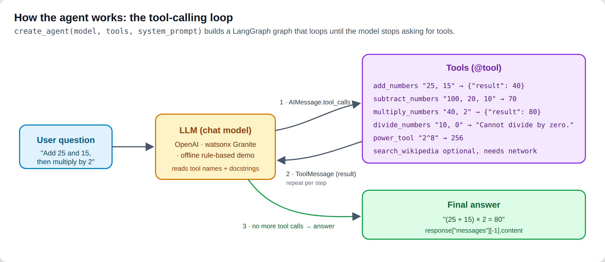
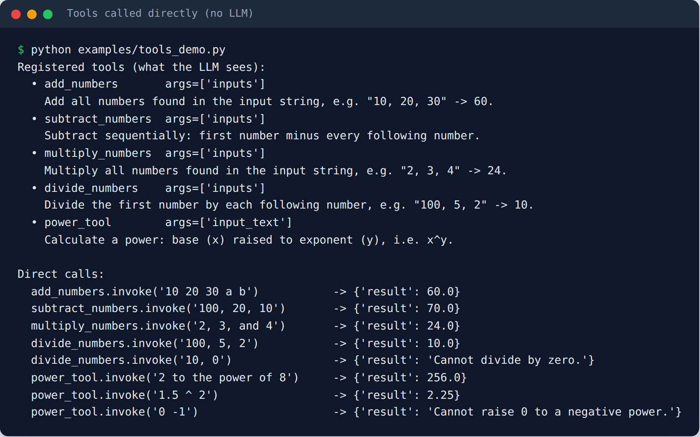
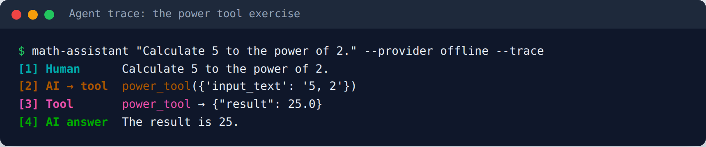
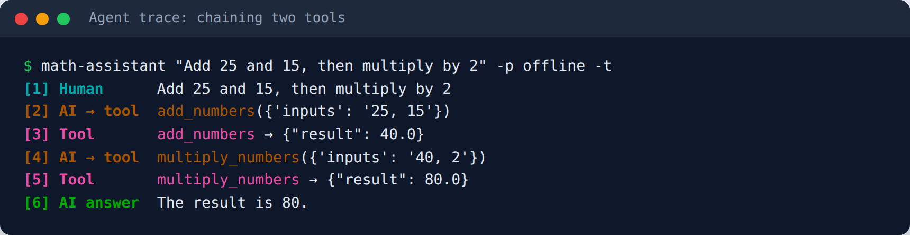
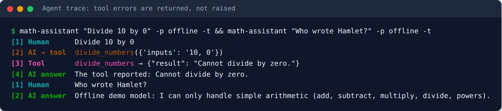
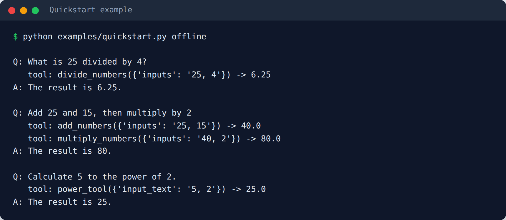
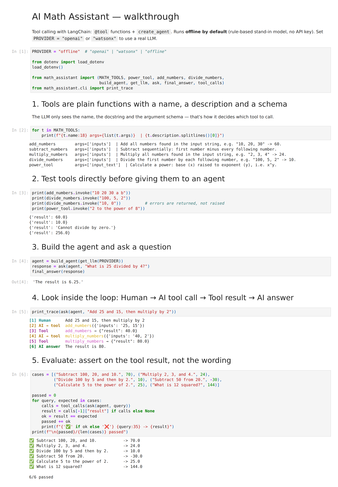
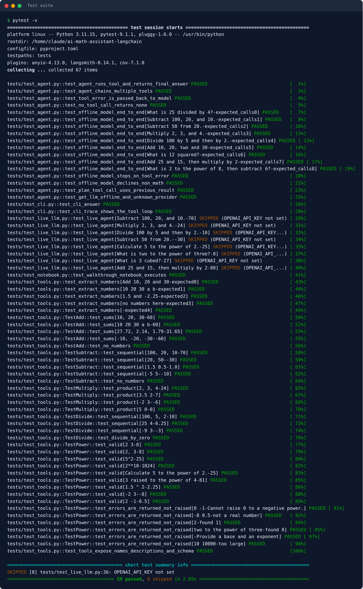
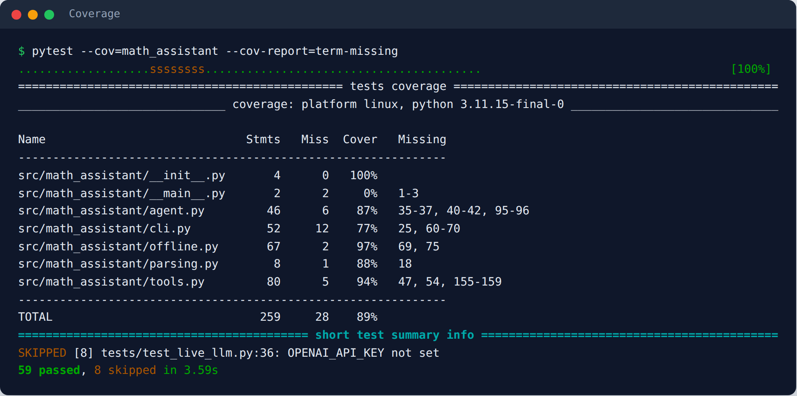

# AI Math Assistant — LangChain Tool Calling

[](https://github.com/<your-user>/ai-math-assistant-langchain/actions/workflows/tests.yml)


An AI agent that solves arithmetic questions written in natural language — *"Add 25 and 15, then multiply by 2"* — by **calling Python tools** instead of guessing numbers. Built with LangChain 1.x `@tool` and `create_agent` (LangGraph under the hood). It works with **OpenAI**, **IBM watsonx Granite**, or a built-in **offline mode** that needs no API key.

> Built as a portfolio version of the lab *"Build an AI Math Assistant with LangChain Tool Calling"* from the IBM **Fundamentals of Building AI Agents** course on Coursera — re-implemented as a tested, installable package. See [Credits](#credits).



---

## Contents

- [Features](#features)
- [Quick start](#quick-start)
- [How it works](#how-it-works)
  - [1. Tools](#1-tools-are-functions-the-llm-can-call)
  - [2. The agent loop](#2-the-agent-loop)
  - [3. Chaining tools](#3-chaining-multiple-tools)
  - [4. Error handling](#4-errors-are-returned-not-raised)
- [Usage](#usage) — CLI · Python API · notebook
- [Testing](#testing)
- [Project structure](#project-structure)
- [Configuration](#configuration)
- [Lessons learned](#lessons-learned)
- [Credits](#credits)

## Features

| | |
|---|---|
| 🧮 **5 math tools** | `add_numbers`, `subtract_numbers`, `multiply_numbers`, `divide_numbers`, `power_tool` (the lab exercise) |
| 📚 **Wikipedia tool** | optional — look up a fact, then compute with it |
| 🔁 **Multi-step reasoning** | the agent chains tool calls: add → multiply, power → subtract, … |
| 🛡️ **Robust input parsing** | integers, decimals, negatives, `2^3`, `2**3`, `"2 to the power of 3"` |
| ⚠️ **Graceful errors** | divide by zero, `0^-1`, missing numbers → a message the agent can explain |
| 🔌 **Pluggable LLM** | `openai` · `watsonx` · `offline` via one setting |
| 🖥️ **CLI with trace mode** | see every message in the tool-calling loop |
| ✅ **59 tests, 89% coverage** | unit, agent-orchestration, CLI and notebook tests run offline in CI; live LLM evals are opt-in |

## Quick start

```bash
git clone https://github.com/<your-user>/ai-math-assistant-langchain.git
cd ai-math-assistant-langchain
python -m venv .venv && source .venv/bin/activate      # Windows: .venv\Scripts\activate
pip install -e ".[openai,dev]"

# No API key? Try the offline mode first:
math-assistant "Add 25 and 15, then multiply by 2" --provider offline --trace

# With a real LLM:
cp .env.example .env        # then put your OPENAI_API_KEY in .env
math-assistant "What is two to the power of ten, minus 24?"
```

## How it works

### 1. Tools are functions the LLM can call

A tool is a normal Python function wrapped with `@tool`. LangChain turns the **name**, **docstring** and **type hints** into a schema the LLM reads to decide *which* tool to use and *what* to pass. That makes the docstring part of the prompt.

```python
from langchain_core.tools import tool

@tool
def power_tool(input_text: str) -> dict:
    """Calculate a power: base (x) raised to exponent (y), i.e. x^y.

    Use for exponents, powers, squares and cubes. Pass base first as digits, e.g.
    "2 3", "2^3" or "2 to the power of 3". Convert words first
    ("two to the power of three" -> "2 3"; "5 squared" -> "5 2").
    """
    return calculate_power(input_text)
```

Every tool returns the same shape — `{"result": <number>}` or `{"result": "<error message>"}` — and is tested directly before an agent ever touches it:



### 2. The agent loop

`create_agent(model, tools, system_prompt)` builds a LangGraph graph that repeats **model → tool → model** until the model stops asking for tools:

```python
from math_assistant import build_agent, get_llm, ask, final_answer

agent = build_agent(get_llm("openai"))           # or "watsonx" / "offline"
response = ask(agent, "Calculate 5 to the power of 2.")
print(final_answer(response))                     # response["messages"][-1].content
```

The response holds the whole conversation. `--trace` prints it:



| # | Message | Meaning |
|---|---|---|
| 1 | `HumanMessage` | the question |
| 2 | `AIMessage.tool_calls` | the model picks `power_tool` and its argument |
| 3 | `ToolMessage` | the tool's JSON result, added to the history |
| 4 | `AIMessage` | no more tool calls → final answer |

### 3. Chaining multiple tools

For multi-step questions the model makes one tool call per step and feeds each result into the next:



With `include_wikipedia=True` the same loop can mix research and math, e.g. *"What is the population of Canada? Multiply it by 0.75"* (`examples/wikipedia_plus_math.py`).

### 4. Errors are returned, not raised

Tools never crash the agent. Bad input comes back as a readable `result`, so the model can explain it. Off-topic questions don't trigger a tool at all:



## Usage

### CLI

```bash
math-assistant "Divide 100 by 5 and then by 2."           # answer only
math-assistant "What is 3 cubed?" --trace                 # show the tool-calling loop
math-assistant "Population of Bulgaria times 2" --wiki    # add the Wikipedia tool
math-assistant --provider watsonx                         # interactive mode (type 'exit' to quit)
python -m math_assistant --help
```

### Python API

```python
from math_assistant import build_agent, get_llm, ask, final_answer, tool_calls, last_tool_result

agent = build_agent(get_llm("offline"))
response = ask(agent, "Add 25 and 15, then multiply by 2")

tool_calls(response)
# [{'name': 'add_numbers', 'args': {'inputs': '25, 15'}, 'result': 40.0},
#  {'name': 'multiply_numbers', 'args': {'inputs': '40, 2'}, 'result': 80.0}]
last_tool_result(response)   # 80.0
```



### Notebook

[`notebooks/walkthrough.ipynb`](notebooks/walkthrough.ipynb) goes through tools → agent → trace → evaluation. It runs offline by default; change `PROVIDER` to use a real LLM.

<details>
<summary>Screenshot of the executed notebook</summary>



</details>

## Testing

```bash
pytest                                         # 59 offline tests (no API key needed)
pytest --cov=math_assistant --cov-report=term-missing
pytest -m live -v                              # real-LLM evaluation, needs OPENAI_API_KEY
```

| Test file | What it checks | Needs LLM? |
|---|---|---|
| `tests/test_tools.py` | parsing and every tool: decimals, negatives, notations, error messages, schemas | no |
| `tests/test_agent.py` | the real `create_agent` loop with a scripted fake model: message order, chaining, error propagation, result extraction; plus the offline model end to end | no |
| `tests/test_cli.py` | CLI answer and trace output | no |
| `tests/test_notebook.py` | the walkthrough notebook runs top to bottom | no |
| `tests/test_live_llm.py` | the lab's test cases against a real model — asserts on the **tool result**, not the wording | yes |

**How to test an LLM agent:** make the parts that can be deterministic (tools, orchestration) fully deterministic and test them in CI. Keep real-model tests as a separate, opt-in **evaluation** that checks *which tool was called with what result*, because the model's wording changes between runs.





CI (`.github/workflows/tests.yml`) runs the offline suite on Python 3.10–3.12. It also runs the live evaluation on push, but only if you add an `OPENAI_API_KEY` repository secret.

## Project structure

```
ai-math-assistant-langchain/
├── src/math_assistant/
│   ├── tools.py        # @tool definitions + plain functions (add, subtract, multiply, divide, power, wikipedia)
│   ├── parsing.py      # number extraction shared by all tools
│   ├── agent.py        # get_llm() provider switch, build_agent(), response helpers
│   ├── offline.py      # rule-based stand-in chat model for key-free demos/tests
│   └── cli.py          # `math-assistant` command with --trace
├── tests/              # pytest suite (offline + opt-in live)
├── examples/           # quickstart, tools demo, wikipedia + math
├── notebooks/          # walkthrough.ipynb (executed)
├── scripts/            # build_notebook.py, make_screenshots.py
├── docs/images/        # screenshots used in this README
└── .github/workflows/  # CI
```

## Configuration

Copy `.env.example` to `.env`:

| Variable | Default | Used for |
|---|---|---|
| `LLM_PROVIDER` | `openai` | `openai` · `watsonx` · `offline` |
| `OPENAI_API_KEY` / `OPENAI_MODEL` | – / `gpt-5.4-nano` | OpenAI |
| `WATSONX_APIKEY`, `WATSONX_PROJECT_ID` | – | IBM watsonx.ai |
| `WATSONX_URL` / `WATSONX_MODEL` | us-south / `ibm/granite-4-h-small` | IBM watsonx.ai |

Optional extras: `pip install -e ".[openai]"`, `".[watsonx]"`, `".[wiki]"`, `".[dev]"` or `".[all]"`.

### About offline mode

`OfflineMathModel` is **not an LLM**. It's a small keyword-rule model that uses the same tool-calling protocol (it emits `tool_calls` and reads `ToolMessage`s). With it, the real agent loop and real tools run without an API key, which is useful for demos, CI and screenshots. It only understands simple arithmetic phrasing (optionally chained with "then"). For open-ended language, use `openai` or `watsonx`.

All screenshots in this README are real output of the commands shown, generated in offline mode by `python scripts/make_screenshots.py`.

## Lessons learned

- **The docstring is the prompt.** Tool choice and argument format depend on the description, e.g. telling the model to put the base first and convert "two" to 2.
- **Tool behaviour must match what people expect.** In the original lab a subtract tool that didn't compute `a − b − c` made the agent retry in a loop. Tools should do what their name promises.
- **Give each tool one clear job.** Duplicate or overlapping tools confuse the model.
- **Return errors as data.** `{"result": "Cannot divide by zero."}` lets the agent recover; an exception ends the run.
- **Parse robustly.** A regex that handles decimals and negatives (`-?\d+(?:\.\d+)?`) beats `str.isdigit()`, which silently drops `-5`, `2.5` and `"10."`.
- **Evaluate on tool results.** Check the `ToolMessage`, not the model's wording.

## Credits

- Concept and exercises: IBM Skills Network lab *Build an AI Math Assistant with LangChain Tool Calling* (J. Santarcangelo, K. Makwana), part of **Fundamentals of Building AI Agents** on Coursera. The original lab notebook is IBM-copyrighted and is **not** included here; this repo is an independent re-implementation.
- Built with [LangChain](https://python.langchain.com/) and [LangGraph](https://langchain-ai.github.io/langgraph/).

## License

[MIT](LICENSE) © VictorV
